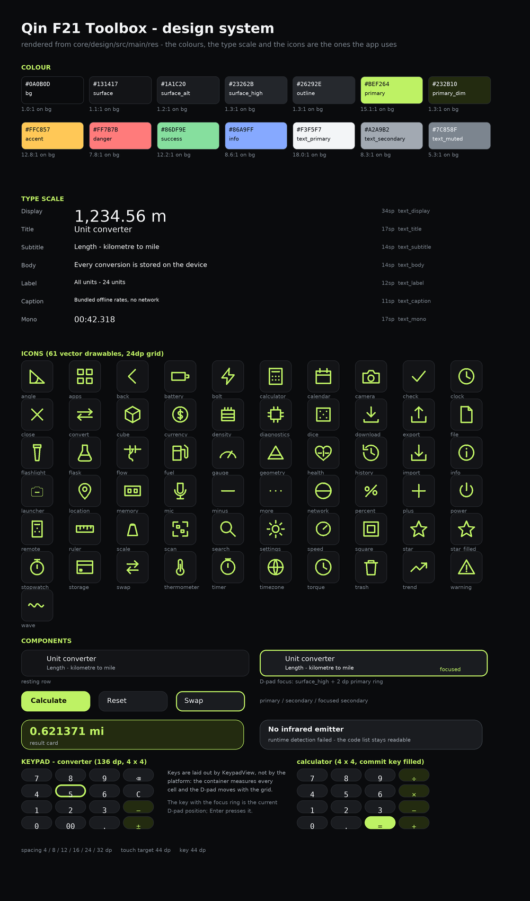

# Qin F21 Toolbox

An **offline utility toolbox** for the Qin F21 Pro (Xiaomi Qin F21 Pro, 2.8" 480 × 640,
Android 11 / API 30). The app contains 21 tools in five categories, uses no third party
runtime dependency, has **no `INTERNET` permission** and never contacts a server.

```
Convert   Unit converter · Currency · Time zones · Date & time
Calculate Calculator · Quick calculators · Geometry
Measure   Stopwatch · Timer · Sound meter
Media     QR & barcode · Camera · Voice recorder · Infrared remote · Flashlight
Device    GPS · Diagnostics · History · Favourites · Settings · About
```

---

## What it does

| Tool | Highlights |
|------|------------|
| **Unit converter** | 18 categories, 200+ units (metric, imperial, nautical, astrophysical, cooking, typography, …), one tap swap, a "all units" list, numeric keypad entry, unit pairs can be pinned as favourites |
| **Currency** | 76 currencies with **bundled** reference rates (dated, editable in Settings, no network), quick swap |
| **Time zones** | World clock built on the device IANA database (DST aware), offset difference, curated zone list |
| **Date & time** | Difference between two dates, add/subtract intervals, age calculator |
| **Calculator** | Scientific expression engine (functions, constants, `ANS`, implicit multiplication, factorial), history |
| **Quick calculators** | Percentage, percentage change, discount/tax/tip, bill splitting, BMI, loan, interest, GCD/LCM/primes, Roman numerals, number bases, random numbers, fuel cost, speed/pace, cooking time, age |
| **Geometry** | Circle, rectangle, triangle, right triangle, trapezoid, sphere, cylinder |
| **Stopwatch** | Lap times with split times, `SystemClock` based (accurate while the screen is off) |
| **Timer** | Countdown with vibration and a notification, preset durations |
| **Sound meter** | Live dB estimate, dBFS, RMS, peak, 7 band spectrum, calibration offset |
| **Voice recorder** | WAV recording, level meter, share the clips from the app |
| **QR & barcode** | Camera2 based scanning, decoding **on the device** (vendored ZXing core) |
| **Camera** | Photo capture through Camera2, stored on the device, shareable |
| **Infrared remote** | Bundled NEC code lists + custom hex patterns (only offered when an IR emitter exists) |
| **Flashlight** | Turns the camera LED into a torch (only offered when a flash unit exists) |
| **GPS** | Position, altitude, speed, bearing, accuracy, satellites in view / used, copy coordinates |
| **Diagnostics** | Device, display, memory, storage, battery, sensors, network — read live from the platform |
| **History / Favourites** | Local only, export as JSON or CSV, import a backup |
| **Settings** | Keep screen on, microphone calibration, exchange rate overrides, data import/export |

Everything is designed for the **small 4:3 screen and the physical T9 keypad** of the
device: large read-outs, compact rows, full D-pad navigation and numeric entry through
the hardware keys.

---

## Offline guarantees

* The manifest does **not** declare `android.permission.INTERNET` – the process cannot
  open a socket at all.
* No ads, no analytics, no crash reporting, no cloud, no account.
* Exchange rates, infrared codes and all reference data are **bundled inside the APK**
  (`app/src/main/assets/data/`).
* The barcode decoder is the Apache-2.0 licensed ZXing *core*, vendored in
  `third_party/zxing-core/` – no code or image leaves the device.
* The permissions are `CAMERA`, `RECORD_AUDIO`, `ACCESS_FINE_LOCATION`,
  `ACCESS_COARSE_LOCATION`, `VIBRATE` and `POST_NOTIFICATIONS`. The three dangerous ones
  are requested only from the tool that needs them (camera, microphone, GPS) with an
  explicit "Grant permission" button, never at startup. `VIBRATE` is install-time, and the
  timer's notification degrades to a vibration alone if notifications are blocked.

## Hardware honesty

The app **detects the hardware at runtime** and never fakes a measurement:

* no accelerometer / gyroscope / magnetometer / barometer → the matching tools are not
  offered at all (there is no level, no step counter, no compass);
* no IR emitter → the infrared screen explains the situation instead of pretending;
* no flash unit → the flashlight is disabled with a clear message;
* no camera / no microphone → the tool shows an "unavailable" state;
* the sound meter shows the **exact** dBFS value next to the estimated dB value and
  documents that phone microphones are not calibrated.

See [`docs/HARDWARE.md`](docs/HARDWARE.md) for the per-tool support matrix.

---

## Design system



The sheet is rendered directly from `core/design/src/main/res` by
`tools/render_design_sheet.py`, so it shows the shipped palette, type scale and the full
61-icon set rather than a mock-up. It is a rendering of the resources, not a screenshot
of the running app.

## Building

Two build paths are supported, both produce the same app.

### 1. Offline pipeline (no Android SDK needed)

```bash
tools/fetch-toolchain.sh     # one time: JDK 11, kotlinc, aapt2, d8, apksigner
tools/build-offline.sh       # aapt2 -> javac -> kotlinc -> d8 -> package -> sign
```

The signed debug APK is written to `build/outputs/qin-f21-toolbox-1.0.0.apk`.

### 2. Gradle (needs a local Android SDK with platform 30)

```bash
./gradlew :app:assembleRelease
```

See [`docs/BUILD.md`](docs/BUILD.md) for details and for the tool-chain download notes.

## Testing

```bash
tools/selftest.sh             # 183 checks over the pure Kotlin modules
```

The JSON, conversion, currency, time zone, expression and calculator modules do not use
the Android framework, so they are verified on a plain JVM. **No physical Qin F21 Pro and
no emulator were available in the build environment**, so the Android UI itself was not
executed – see [`docs/TESTING.md`](docs/TESTING.md) for what that means and what is
still unverified.

## Measured size

| Item | Size |
|------|------|
| Signed APK | **1.11 MiB** (1,161,286 bytes) |
| `classes.dex` | 3.05 MB (1.02 MB compressed inside the APK) |
| Compiled resources | 34.5 KB |
| Bundled assets (rates, IR codes) | 1.1 KB |
| Uncompressed payload | 3.17 MB |

The installed size is therefore around 4–5 MB (APK + extracted dex/resources), well
below the 35 MB target. The number above is measured from the signed artefact with
`tools/build-offline.sh`; no device measurement was possible.

## Repository layout

```
app/            the Android application (single activity, screen stack)
core/common/    JSON parser/writer, number formatting      (pure Kotlin)
core/conversion/ unit catalog + conversion engine          (pure Kotlin)
core/calc/      expression engine + calculators            (pure Kotlin)
core/hardware/  capability detection, torch, IR, GNSS, mic  (Android)
core/data/      local store, settings, file provider        (Android)
core/design/    colours, type scale, drawables, icons      (resources)
third_party/    vendored ZXing core (Apache 2.0)
tools/          offline build, self test, icon generator, design sheet renderer
docs/           build, testing, hardware and architecture notes
```

## Licence

The application code is provided as is. `third_party/zxing-core` is the ZXing core
library, © ZXing authors, Apache License 2.0 – the licence text is in
`third_party/zxing-LICENSE`.
